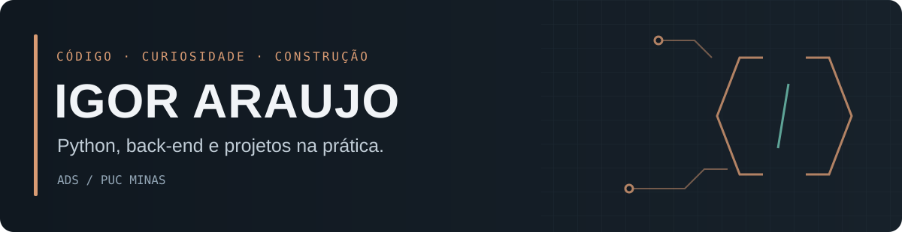

  

# Oi, eu sou o Igor.

Estudante de **Análise e Desenvolvimento de Sistemas na PUC Minas**, em transição para desenvolvimento de software e com foco em **Python e back-end**.

Gosto de entender como as coisas funcionam e transformar essa curiosidade em projetos: de APIs e automações a ferramentas para o meu PC e experimentos com jogos.

Minha trajetória profissional vem da área industrial. Hoje, estou construindo meu caminho em tecnologia por meio da graduação, estudos e projetos práticos.

[LinkedIn](https://www.linkedin.com/in/igorlaraujo/) · [Meus repositórios](https://github.com/igorlaraujo?tab=repositories)

## O que estou construindo

| Projeto | O que estou praticando |
| :--- | :--- |
| **Covered** · projeto acadêmico em equipe | Projeto da graduação na PUC Minas. Um espaço para praticar desenvolvimento web, colaboração e organização do trabalho com Git e GitHub. |
| **RyzenSdkTelemetry** · projeto pessoal | Monitoramento local do meu computador com o SDK oficial da AMD: coletor em C++, histórico por sessão, estatísticas de temperatura e potência e painel local em Python. |
| [**Vaelgor’s Vault**](https://github.com/igorlaraujo/VaelgorsVault) | Mod de Baldur’s Gate 3 em desenvolvimento. Um espaço para explorar organização de inventário, comportamento de jogo e ferramentas de criação. |

## Tecnologias que aparecem nos meus projetos

**Back-end:** Python · FastAPI · SQLAlchemy · PostgreSQL · SQLite  
**Ferramentas locais:** C++ · CMake · integração com SDK AMD  
**Qualidade e ferramentas:** Pytest · Git · GitHub Actions · Docker / Compose  
**Web:** HTML · CSS · JavaScript

Uso cada projeto para aprofundar esses conhecimentos, testar decisões e melhorar a organização do código.

## Além das APIs

- **IA aplicada ao desenvolvimento:** explorando assistentes e ferramentas para apoiar a criação de software.
- **Jogos e modding:** aprendendo com projetos que conectam programação e criatividade.
- **Hardware e automação:** criando ferramentas para acompanhar e entender o comportamento do meu computador.

---

**Por aqui:** projetos de estudo, experimentos pessoais e a evolução do meu caminho em desenvolvimento de software.
